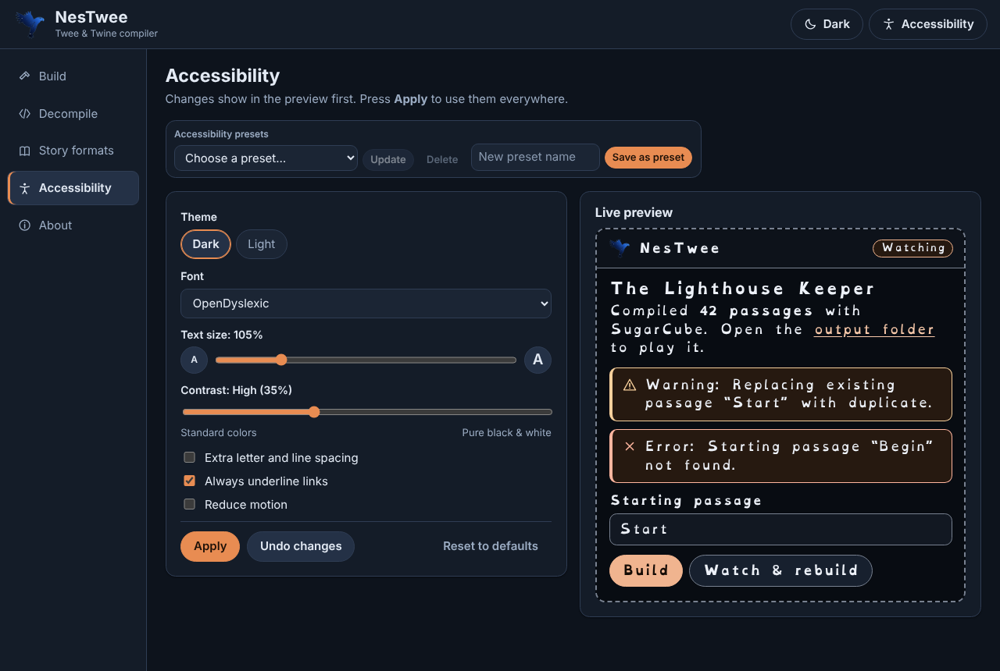

<p align="center">
	
</p>

<h1 align="center">NesTwee</h1>

<p align="center">A desktop app that does everything <a href="https://github.com/tmedwards/tweego">Tweego</a> does, with buttons instead of command-line flags.</p>

NesTwee compiles Twee and Twine sources into playable HTML stories, makes Twine 1 and Twine 2 archives, decompiles stories back into Twee, and can watch your folders and rebuild every time you save. It has a dark theme by default, a light theme, and an accessibility panel with OpenDyslexic, text sizing and a contrast slider that goes all the way to pure black and white.


| Accessibility panel with live preview | Contrast slider at maximum (light) | Light theme |
| --- | --- | --- |
|  |  |  |

## What it can do

| Tweego option | Where it lives in NesTwee |
| --- | --- |
| `sources…` (searched recursively) | **Build → Sources → Add folders…** (folder picker, searched recursively, with a live count of what was found) |
| `-o, --output` | **Build → Output file** |
| `-f, --format` | **Build → Story format** (or *Automatic*, which reads your `StoryData` passage) |
| `-s, --start` | **Build → Starting passage** |
| `-t, --test` | **Build → Test mode** |
| `-a, --archive-twine2` / `--archive-twine1` | **Build → What to make** |
| `-d, --decompile-twee3` / `--decompile-twee1` | **Decompile** page |
| `-m, --module` | **Build → Modules, head file & advanced options** |
| `--head` | **Build → Head file** |
| `-c, --charset` | **Build → Input character set** |
| `--no-trim` | **Build → Trim whitespace around passages** |
| `--twee2-compat` | **Build → Twee2 compatibility mode** |
| `-w, --watch` | **Build → Watch & rebuild** |
| `-l, --log-stats` / `--log-files` | **Build → advanced options** (shown in the log panel) |
| `--list-formats` | **Story formats** page |
| `TWEEGO_PATH` and `storyformats` folders | **Story formats → Search folders** (and still honoured automatically) |

Extras that Tweego doesn't have:

- **Presets** for build settings (format, start passage, options and, if you like, your folders) and for accessibility settings. A few built-in presets are included.
- **A missing-IFID helper** that shows the `StoryData` snippet to paste, with copy buttons.
- **Bundled story formats**: SugarCube 2.37.3, Harlowe 3.3.9, Chapbook 1.2.3, Snowman 2.0.2, Duplex 1.8.0 and Paperthin 1.0.0, so it works straight away.
- **Any other format, including proofing formats**: **Import format.js…** copies any Twine 2 story or proofing format into NesTwee, and **Proofing copy** builds your story with a proofing format of your choice.
- **A command-line twin**, `nestwee-cli`, that accepts Tweego's flags (handy for scripts and CI).

## Getting started (step by step)

You need **Node.js 20 or newer** (which includes `npm`). Get it from [nodejs.org](https://nodejs.org/) if you don't have it.

1. **Get the code.**
   ```sh
   git clone https://github.com/Techy-Nature/Nestwee.git
   cd Nestwee
   ```
2. **Install the dependencies.** This also downloads Electron, which can take a minute.
   ```sh
   npm install
   ```
3. **Start the app.**
   ```sh
   npm start
   ```
4. **Build the example story** to check everything works:
   1. On the **Build** page, press **Add folders…** and choose `examples/hello-hawk/src`.
   2. Press **Choose…** next to *Output file* and save it as `hello-hawk.html` anywhere you like.
   3. Press **Build** (or <kbd>Ctrl</kbd>+<kbd>B</kbd>).
   4. Press **Open output** to play it in your browser.

For a deeper walkthrough (watch mode, modules, presets, adding story formats, building installers, troubleshooting), see the **[User guide](docs/GUIDE.md)**.

## Making an installer

### The easy way: let GitHub build them

The repository has a GitHub Actions workflow (`.github/workflows/build.yml`) that builds the Windows, macOS and Linux apps on GitHub's own Windows, Mac and Linux machines.

1. Push to `main`, open a pull request, or start it by hand: **Actions** tab → **Build apps** → **Run workflow**.
2. When it finishes (about 5–10 minutes), open the run and download **NesTwee-Windows**, **NesTwee-macOS** or **NesTwee-Linux** from the **Artifacts** section at the bottom.
3. To publish a release, push a version tag, for example:
   ```sh
   git tag v0.1.0
   git push origin v0.1.0
   ```
   The apps are then attached to a GitHub Release automatically.

The apps aren't code-signed yet, so Windows SmartScreen and macOS Gatekeeper will warn the first time they're opened (on a Mac: right-click the app → **Open**).

### Building on your own computer

```sh
npm run dist        # for the computer you're on
npm run dist:win    # Windows installer + portable .exe
npm run dist:mac    # macOS .dmg (Apple only allows this on a Mac)
npm run dist:linux  # AppImage + .deb
```

The finished files land in the `dist/` folder.

## Using the command line version

```sh
npx nestwee-cli -o story.html path/to/src          # compile
npx nestwee-cli -d -o story.twee story.html        # decompile
npx nestwee-cli -w -o story.html path/to/src       # watch
npx nestwee-cli --list-formats
npx nestwee-cli --help
```

## Development

```sh
npm test                        # engine tests (Node's built-in test runner)
node scripts/generate-logo.js   # regenerate assets/logo.svg and assets/icon.svg
```

How the code is laid out:

```
src/engine/    The compiler: a JavaScript port of Tweego (lexer, story model, formats, modules, watch)
src/main/      Electron main process: window, dialogs, settings file, IPC
src/renderer/  The interface: index.html, styles.css, app.js
src/cli.js     Command-line front end with Tweego-compatible flags
storyformats/  Bundled story formats
assets/        Logo, app icon and the OpenDyslexic font
```

### Why Electron, and why a port instead of wrapping the `tweego` binary?

- **Electron** gives one codebase for Windows, macOS and Linux, a mature file/folder picker, and the web platform's accessibility features (screen readers, focus handling, font loading) for free.
- **Porting Tweego to JavaScript** instead of bundling the Go binary means there's nothing extra to download per platform, errors come back as structured messages the interface can explain (like the IFID helper), and watch mode, folder scanning and presets all share one engine. The port follows Tweego's source closely (lexer, passage ordering, `StoryData` handling, format selection by name and version, module and head injection), and the test suite checks round-trips between compiling and decompiling.

## Credits and licenses

- NesTwee is released under the BSD 2-Clause license (see [LICENSE.md](LICENSE.md)).
- The compiler is a port of [Tweego](https://github.com/tmedwards/tweego) by Thomas Michael Edwards (BSD 2-Clause).
- Bundled story formats and the OpenDyslexic font keep their own licenses. See [THIRD_PARTY_NOTICES.md](THIRD_PARTY_NOTICES.md).
- The hawk logo is an original design for NesTwee.
